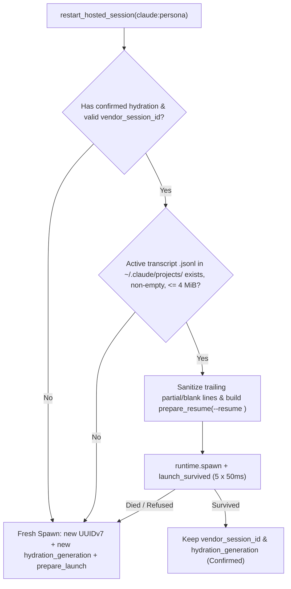

# Claude-Hosted Session `--resume` on Respawn (Issue #433, Path 1) — Design Specification

Status: Proposed on 2026-11-09 (`feira/claude-resume-respawn-433-spec`, Issue #433 Path 1).

---

## 1. Problem Statement (`#433`)

Every restart or redeploy of `ferroloop-host.service` (`fl-host`) terminates the child PTY processes supervised inside `fl-host`, including hosted Claude Code agents (`Ferris`, `Hector`, `Sonya`, `Kayla`). When those hosted sessions are subsequently respawned via `restart_hosted_session` (`POST /api/v1/sessions/:id/restart`) or re-spun via `spin_up` (`POST /api/v1/sessions/spin-up`), `fl-hub` launches a brand-new Claude Code conversation (`claude --remote-control --permission-mode <mode> --session-id <id> --name <DisplayName> ... <hydration_prompt>`).

Meanwhile, the prior Claude process's Remote Control bridge session (`bridgeSessionId: "cse_..."` in `~/.claude/sessions/<pid>.json`) was never closed gracefully when `fl-host` stopped. As a result, each `fl-host` restart leaves one disconnected Remote Control entry per Claude-hosted agent in the owner's Claude Recents list (4 stale entries per restart across `Ferris`, `Hector`, `Sonya`, and `Kayla`), discards the agent's in-flight conversation context, and pays a full startup hydration turn (~10k–25k tokens and 15–45 seconds).

### Central Question for Path 1

Can a Claude-hosted respawn resume the recorded `vendor_session_id` via `claude --resume <vendor_session_id>` so that a host restart reuses the existing conversation transcript (and, if supported by Claude Code's `--remote-control --resume` path, reattaches or replaces the Remote Control bridge session) instead of starting a fresh session and stranding a disconnected Recents entry per agent?

---

## 2. How the Claude Adapter and Hub Lifecycle Build the Spawn Argv Today

### 2.1 Adapter Layer (`crates/vendor-adapters/src/claude.rs`)

`ClaudeHostAdapter` (`crates/vendor-adapters/src/claude.rs:48-50`) already implements both fresh launch and explicit session resume on the `VendorHostAdapter` trait:

1. **`ClaudeHostAdapter::prepare_launch` (`crates/vendor-adapters/src/claude.rs:451-513`):**
   - Takes `&VendorLaunchRequest` and builds:
     ```text
     claude [--remote-control] <posture_launch_args> [--session-id <vendor_session_id> [--name <DisplayName>]] [--model <model>] [--effort <effort>] [<initial_prompt>]
     ```
   - Places `--remote-control` before `--permission-mode <mode>` (`crates/vendor-adapters/src/claude.rs:455-478`) so Commander.js `--remote-control [name]` never consumes a trailing positional `<initial_prompt>`.
   - Appends `safe_positional_prompt(&request.initial_prompt)` (`crates/vendor-adapters/src/claude.rs:500-502`) as the startup hydration prompt.

2. **`ClaudeHostAdapter::prepare_resume` (`crates/vendor-adapters/src/claude.rs:515-566`):**
   - Already exists and is unit-tested (`prepare_resume_requires_explicit_session_id_and_never_uses_continue` at `crates/vendor-adapters/src/claude.rs:1150-1192`), but has **zero production callers** in `crates/hub/`.
   - Validates `request.vendor_session_id` via `validate_required_session_id(&request.vendor_session_id, "prepare_resume")` (`crates/vendor-adapters/src/claude.rs:532-533`), forbidding `--continue` and newest-by-`mtime` scanning.
   - Builds:
     ```text
     claude [--remote-control] <posture_launch_args> --resume <vendor_session_id> [--name <DisplayName>] [--model <model>] [--effort <effort>]
     ```
   - Takes **no** positional `initial_prompt` argument.

### 2.2 Hub Lifecycle Layer (`crates/hub/src/lifecycle.rs`)

Today, both lifecycle entry points that spawn or respawn a hosted Claude runtime bypass `prepare_resume`:

1. **`launch_spec_for_with_session` (`crates/hub/src/lifecycle.rs:762-872`):**
   - Constructs a `fl_core::VendorLaunchRequest` and unconditionally calls `host_adapter.prepare_launch(&req)` (`crates/hub/src/lifecycle.rs:801`), passing `vendor_session_id` into `--session-id <uuid>` and `prompt` as the positional initial prompt.
   - There is no `resume_spec_for_with_session` helper in `crates/hub/src/lifecycle.rs` that constructs an `fl_core::AttachOrResumeRequest` and calls `host_adapter.prepare_resume(&req)`.

2. **`restart_hosted_session` (`crates/hub/src/lifecycle.rs:5640-5826`):**
   - Preserves `record.vendor_session_id` if already populated on `HostedSessionRecord`, minting a new UUIDv7 only when `record.vendor_session_id` is `None` or blank (`crates/hub/src/lifecycle.rs:5669-5676`):
     ```rust
     if record.vendor == "claude"
         && record
             .vendor_session_id
             .as_deref()
             .is_none_or(|s| s.trim().is_empty())
     {
         record.vendor_session_id = Some(uuid::Uuid::now_v7().to_string());
     }
     ```
   - However, at lines `5741-5760`, `restart_hosted_session` passes that preserved `record.vendor_session_id` to `launch_spec_for_with_session(...)`, which invokes `prepare_launch` (`claude ... --session-id <existing_uuid> ... <hydration_prompt>`).
   - Worse: when `<existing_uuid>.jsonl` already exists on disk from the pre-restart process, `claude --session-id <existing_uuid>` either refuses the duplicate session ID or re-runs the full positional hydration prompt instead of resuming via `--resume <existing_uuid>`.

3. **`spin_up` (`crates/hub/src/lifecycle.rs:4148-4391`):**
   - Even when `previous` (`find_hosted_session(store, &[&session_id])` at `crates/hub/src/lifecycle.rs:4193-4194`) is a live or `stopped` hosted record for the same `claude:<persona>` session, line `4242` unconditionally overwrites `vendor_session_id` with a brand-new UUIDv7:
     ```rust
     let vendor_session_id = (v.vendor == "claude").then(|| uuid::Uuid::now_v7().to_string());
     ```

---

## 3. What Is Recorded in `HostedSessionRecord` (`vendor_session_id`) and Reliability Analysis

### 3.1 Lifecycle of `HostedSessionRecord.vendor_session_id`

`HostedSessionRecord` (`crates/hub/src/lifecycle.rs:2144-2200`) stores the vendor-native session UUID in:

```rust
/// Vendor-native session identifier (e.g., Claude `--session-id <uuid>`).
#[serde(default, skip_serializing_if = "Option::is_none")]
pub vendor_session_id: Option<String>,
```

At `spin_up`:
1. `vendor_session_id` is minted as `Uuid::now_v7().to_string()` (`crates/hub/src/lifecycle.rs:4242`).
2. `persist_hosted_session(store, &record, by)` (`crates/hub/src/lifecycle.rs:2496-2531`, called at line `4310`) writes the `HostedSessionRecord` to `fl-store` under workspace runtime slug `hosted-session-claude-<persona>` **before** `env.runtime.spawn(...)` runs (`crates/hub/src/lifecycle.rs:4318-4327`).
3. `env.runtime.spawn` launches `claude --remote-control ... --session-id <vendor_session_id> --name <DisplayName> ...`.

### 3.2 Three On-Disk Artifacts per Claude Session

Across the host, three artifacts track the session:

1. **`fl-store` (`hosted-session-claude-<persona>`):**
   - Holds `HostedSessionRecord.vendor_session_id: Some("<uuid>")`.
   - Durable across `fl-host` restarts, `fl-hub` restarts, and host reboots.
2. **`~/.claude/sessions/<pid>.json` (and `<pid>.<sha256>.key`):**
   - Ephemeral process metadata written by Claude Code while `<pid>` is alive, inspected by `discover_claude_routes` (`crates/wire/src/identity.rs:1200-1274`) and `claude-session-snapshot.py`:
     - `pid`: OS PID of the `claude` process
     - `name`: `<DisplayName>` passed via `--name` (e.g., `"Ferris"`)
     - `sessionId`: `<vendor_session_id>` UUID
     - `bridgeSessionId`: Remote Control session ID (`"cse_..."`) shown in Claude Recents
     - `messagingSocketPath`: Unix domain socket for `fl-wire` push delivery
     - `cwd`, `startedAt`, `status`, `version`
   - When `fl-host` stops and kills its child processes, `<pid>` dies; `discover_claude_routes` filters dead PIDs out via `Path::new(&format!("/proc/{pid}")).exists()` (`crates/wire/src/identity.rs:1227`).
3. **`~/.claude/projects/<project-slug>/<vendor_session_id>.jsonl`:**
   - Append-only JSONL conversation transcript written by Claude Code on every user/assistant/tool turn.
   - Located deterministically by `ClaudeHostAdapter::find_session_transcript_path(home_dir, vendor_session_id)` (`crates/vendor-adapters/src/claude.rs:97-124`), which matches only the exact `<vendor_session_id>.jsonl` filename under `~/.claude/projects/*/` (and `~/.claude/archived/*/`), never scanning by `mtime`.

### 3.3 Reliability Analysis and the `/clear` Drift Edge Case

Is `HostedSessionRecord.vendor_session_id` reliable as the `--resume` target when a Claude session is respawned?

- **Normal operation and `fl-host` restarts:** **Yes (100% match).** Because `--session-id <uuid>` is passed on initial launch and persisted to `fl-store` before spawn, `HostedSessionRecord.vendor_session_id` matches both `~/.claude/sessions/<pid>.json`'s `sessionId` and `~/.claude/projects/<project-slug>/<uuid>.jsonl`.
- **Single drift edge case — interactive `/clear` inside a running session:**
  - If an operator attaches to the terminal and runs `/clear` inside Claude Code without going through `fl-hub`, Claude Code rotates its active `sessionId` in `~/.claude/sessions/<pid>.json` and opens a new `<new_uuid>.jsonl` transcript, while `HostedSessionRecord.vendor_session_id` in `fl-store` still holds the initial `<uuid>`.
  - Meanwhile, `discover_claude_routes` (`crates/wire/src/identity.rs:1257-1272`) and `fl wire hook claude` (`crates/cli/src/cmd/wire.rs:1344-1384`) update `VendorRoute::Claude { session_id, .. }` in `routes.json` to `<new_uuid>`.
- **Closing the drift:**
  - Whenever `reconcile_dead_hosted_sessions` (`crates/hub/src/lifecycle.rs:5242-5292`) sees a live `VendorRoute::Claude { session_id, .. }` for `record.persona` whose `session_id` is a valid non-empty Claude session ID (`is_native_session_id(&session_id)`) that differs from `record.vendor_session_id` (and is not in `record.tombstone_ids`), or at the start of `restart_hosted_session` before the old route is replaced, `fl-hub` syncs `record.vendor_session_id = Some(route_session_id)` if `<route_session_id>.jsonl` exists under `~/.claude/projects/`.
  - Even without a prior sync, if `/clear` happened before the initial transcript wrote any turns, the preflight transcript check (Section 6.1) detects the missing/empty `.jsonl` and falls back cleanly.

---

## 4. Interaction with `#406` Generation-Fenced Hydration and Route Re-Binding

### 4.1 Why Treating `--resume` Like a Fresh Launch Breaks `#406`

Under Issue `#406` ([`2026-11-09-hydration-acceptance-406-design.md`](2026-11-09-hydration-acceptance-406-design.md) and `crates/hub/src/lifecycle.rs:2215-2494`):
- A fresh launch mints `G1 = next_hydration_generation()`, sets `record.hydration_generation = Some(G1)` and `record.hydration_status = HydrationStatus::Unconfirmed`, embeds `AGENT_PERSONA=<persona> AGENT_HYDRATION_GENERATION=<G1> fl wire register <Name> --project <project> --role <role> --replace` in Step 6 of the positional hydration prompt, and passes `AGENT_HYDRATION_GENERATION=<G1>` in the spawned process environment (`apply_vendor_launch_env`, `crates/hub/src/lifecycle.rs:697-714`).
- When the agent executes Step 6, `record_hydration_ack` (`crates/hub/src/lifecycle.rs:2424-2494`) writes workspace runtime entry `hydration-ack-<G1>`, and `promote_confirmed_hydration` / `list_hosted_sessions` (`crates/hub/src/lifecycle.rs:2309-2328`, `2558-2566`) projects `record.hydration_status = HydrationStatus::Confirmed`.
- When `persist_hosted_session` runs (`crates/hub/src/lifecycle.rs:2524`), `prune_stale_hydration_receipts` (`crates/hub/src/lifecycle.rs:2330-2365`) deletes any `hydration-ack-*` for `persona` whose generation does not match `record.hydration_generation`.

If `restart_hosted_session` on `--resume` minted a new generation `G2`, reset `record.hydration_status = HydrationStatus::Unconfirmed`, and pruned `hydration-ack-<G1>`, two bugs would occur immediately:
1. **Permanent `Unconfirmed` status:** `ClaudeHostAdapter::prepare_resume` takes no positional prompt, and a resumed session does not re-run startup hydration Step 6 unless prompted. Thus `hydration-ack-<G2>` would never be written, leaving `hydration_status` stuck at `Unconfirmed`.
2. **False stale-generation refusal (`fence_hydration_register`):** The resumed Claude transcript still contains the earlier Step 6 command string `AGENT_PERSONA=<persona> AGENT_HYDRATION_GENERATION=<G1> fl wire register ... --replace` in its conversation history. If the agent ever re-ran that command from history while `record.hydration_generation == Some(G2)`, `fence_hydration_register` (`crates/hub/src/lifecycle.rs:2369-2419`) would see `G1 < G2` and fail with:
   ```text
   registration refused for `<persona>`: session launch generation `<G1>` was superseded by a newer launch; this process should exit
   ```

### 4.2 Exact `#406`-Compatible Design for Resumed Sessions

A resume (`prepare_resume`) is a **process continuation of the same hydrated conversation**, not a new hydration submission. This aligns directly with `#406` Amendment A8 ("Reuse generation when no new hydration submission is issued"):

1. **Eligibility for Resume (`ResumeEligibility::ResumeExisting`):**
   `restart_hosted_session` (and `spin_up` when re-spinning a `stopped` record of the same `claude:<persona>` session) selects `prepare_resume` when **all** of the following hold:
   - `record.vendor == "claude"` and `record.hosted && env.spawn_runtime`;
   - `record.vendor_session_id` is `Some(sid)` with a valid session UUID not present in `record.tombstone_ids`;
   - `record.hydration_status == HydrationStatus::Confirmed` (projected via `list_hosted_sessions` / `promote_confirmed_hydration`, proving the session accepted its initial hydration before dying) and `record.hydration_generation` is `Some(g)` with `is_valid_hydration_generation(&g)`;
   - No recast guidance is staged (`!recast_guidance_required`, i.e. the agent's project and role have not been reassigned since the session ran);
   - The transcript file at `~/.claude/projects/<project-slug>/<sid>.jsonl` (not in `archived/`) exists, is non-empty, has at least one valid normalized turn, and is within `MAX_CLAUDE_RESUME_TRANSCRIPT_BYTES` (Section 5.2).

2. **No Re-Hydration Prompt on `--resume`:**
   - `restart_hosted_session` builds the `LaunchSpec` via `resume_spec_for_with_session` -> `ClaudeHostAdapter::prepare_resume`, which passes `--resume <sid>` and **no** positional hydration prompt.
   - `RestartResponse.prompt` returns `String::new()` (or the existing role prompt for display only, without dispatching it to the PTY).

3. **Preserving `hydration_generation` and `hydration-ack-<G1>`:**
   - When `ResumeEligibility::ResumeExisting` is chosen and the `--resume` spawn survives `launch_survived`:
     - `record.hydration_generation` stays at `Some(G1)` (not incremented to `G2`).
     - `hydration-ack-<G1>` in `fl-store` is **not** deleted before or after spawn (`prune_stale_hydration_receipts` retains it because `G1` remains in `active_generations`).
     - `apply_vendor_launch_env` injects `AGENT_HYDRATION_GENERATION=<G1>` into the resumed child's environment.
     - `record.hydration_dispatched` remains `true`, and `record.hydration_status` remains `HydrationStatus::Confirmed`.
     - If the resumed process ever runs `fl wire register --replace` again (with `G1` from its environment or Step 6 history), `fence_hydration_register` sees `has_matching_live == true` (`record.hydration_generation == Some(G1)`) and `record_hydration_ack` treats the duplicate receipt idempotently (`crates/hub/src/lifecycle.rs:2450-2462`).
     - Conversely, if a subsequent restart falls back to a fresh spawn (`prepare_launch`), `fl-hub` mints `G2 > G1`, prunes `hydration-ack-<G1>`, and fences out any lingering `G1` subshell as required by `#406` Case 4.

4. **Route Re-Binding for the New PID:**
   - `claude --remote-control ... --resume <sid> --name <DisplayName>` starts a new OS process with a new `pid` and creates `~/.claude/sessions/<new_pid>.json` with `"name": "<DisplayName>"`, `"sessionId": "<sid>"`, and a new `"messagingSocketPath"`.
   - `crate::discovery::invalidate_route_discovery_cache()` (`crates/hub/src/lifecycle.rs:5815`) forces the next route lookup or `boot_reconcile` pass to run `discover_claude_routes` (`crates/wire/src/identity.rs:1200-1274`), which prunes the dead `<old_pid>` entry (`/proc/<old_pid>` is gone) and binds `VendorRoute::Claude { pid: new_pid, session_id: sid, socket_path: new_socket, key_path: new_key }`.
   - In addition, Claude Code fires its `SessionStart` hook (`fl wire hook claude`, `crates/cli/src/cmd/wire.rs:1316-1384`) on `--resume`, which immediately registers the new PID's route in `routes.json`.
   - If the restart was part of a host reboot, `boot_reconcile::reconcile_pass` (`crates/hub/src/boot_reconcile.rs:17-18`, `69-74`) delivers the single `"Host restarted"` system mail once the new route is live.

---

## 5. Context Cost: Resuming a Long Session vs. Fresh Spawn

### 5.1 Token and Latency Comparison

| Dimension | Resume (`claude --resume <id>`) — Warm Cache (`<= 5m` / `1h` TTL) | Resume (`claude --resume <id>`) — Cold Cache | Fresh Spawn (`claude --session-id <new>` + Hydration Prompt) |
| :--- | :--- | :--- | :--- |
| **Startup turns** | **0 turns** (immediately idle at prompt) | **0 turns** until next message; next turn prefills history | **3–6 tool turns** (`fl state handoff`, `fl wire register`, `fl wire read --ack`) |
| **Wall-clock readiness** | **~1–2 s** (process start only) | **~1–2 s** (process start; prefill paid on first turn) | **15–45 s** |
| **Token cost** | **0 tokens at spawn**; ~0.1x cache-read rate on next turn | **0 tokens at spawn**; 1.0x–1.25x input tokens across transcript on next turn | **~10k–25k tokens** on every restart even if idle |
| **In-flight context** | **Preserved** (all recent file reads, diffs, reasoning intact) | **Preserved** | **Lost** unless checkpointed to `fl state handoff` before kill |
| **`sessionId`** | **Reused** (`same`) | **Reused** (`same`) | **Always new UUIDv7** (`NEW`) |

### 5.2 Transcript-Size Guard (`MAX_CLAUDE_RESUME_TRANSCRIPT_BYTES`)

An `fl-host` deploy or service restart typically takes `< 5 seconds`, well inside Anthropic's prompt-cache TTL. Furthermore, `claude --resume <id>` does not issue an API request until the agent receives a new message or operator turn.

However, if a session has accumulated a multi-megabyte `.jsonl` transcript (many tool outputs and file reads), resuming it indefinitely without bound risks:
1. Immediate context-window exhaustion or forced auto-compaction on the very next turn;
2. High cold-cache prefill cost if the agent remains idle past the prompt-cache TTL before its next message.

To bound this cost:
- Define a configurable byte ceiling `MAX_CLAUDE_RESUME_TRANSCRIPT_BYTES` (default `4 * 1024 * 1024` bytes / **4 MiB**, overridable via `FL_CLAUDE_MAX_RESUME_TRANSCRIPT_BYTES`).
- During preflight in `restart_hosted_session`:
  - Check `fs::metadata(&transcript_path)?.len()`.
  - If `len <= max_resume_bytes`, use `prepare_resume` (`--resume <vendor_session_id>`).
  - If `len > max_resume_bytes`, log a lifecycle notice (`"Claude transcript for <persona> (<len> bytes) exceeds resume cap (<cap> bytes); starting fresh session"`) and fall back to a fresh spawn (`--session-id <new_uuid>` with a new `hydration_generation` and full hydration prompt).

---

## 6. Failure Modes and Automatic Fallback to Fresh Spawn

Every failure mode on the `--resume` path must degrade gracefully to today's fresh spawn (`prepare_launch`) within `restart_hosted_session` so a broken or missing transcript never leaves a hosted agent down.



### 6.1 Failure Mode 1: Missing, Archived, or Empty `.jsonl` Transcript

- **Cause:** `spin_up` crashed before Claude wrote its first turn; the transcript was manually deleted or moved to `~/.claude/archived/`; or `/clear` rotated the session ID before any turn was written.
- **Handling:**
  - Add a helper `ClaudeHostAdapter::find_active_session_transcript_path(home_dir, vendor_session_id)` (or inspect the path returned by `find_session_transcript_path`, `crates/vendor-adapters/src/claude.rs:97-124`, restricting to `~/.claude/projects/` and excluding `~/.claude/archived/`).
  - Verify `metadata.len() > 0` and `normalize_session_transcript_file(&path, None)` (`crates/vendor-adapters/src/claude.rs:128-142`) returns `!report.turns.is_empty()`.
  - If missing, archived, empty, or zero turns: skip `prepare_resume`, mint a fresh `vendor_session_id = Uuid::now_v7().to_string()` and a fresh `hydration_generation = next_hydration_generation()`, and run `prepare_launch` with the full hydration prompt.

### 6.2 Failure Mode 2: Truncated Trailing JSONL Line After Abrupt `SIGKILL`

- **Cause:** `fl-host` died mid-write while Claude Code was flushing a JSONL line to `<vendor_session_id>.jsonl`, leaving a partial trailing line without a closing `}` or newline.
- **Handling:**
  - Before spawning `claude --resume <id>`, run a transcript tail-repair pass (`repair_session_transcript_tail(&path)` in `crates/vendor-adapters/src/claude.rs`):
    - Read the trailing lines of `<vendor_session_id>.jsonl`.
    - If the final non-empty line fails `serde_json::from_str::<Value>` while earlier lines parse as valid JSON objects, truncate the file back to the end of the last complete valid JSON line (plus `\n`).
    - If no valid JSON line remains after truncation, fall back to Failure Mode 1 (fresh spawn).

### 6.3 Failure Mode 3: `claude --resume <id>` Exits Immediately (`!launch_survived`)

- **Cause:** Claude Code rejects `--resume <id>` at startup (e.g., incompatible transcript schema version, corrupted session state, or remote-control flag conflict) and exits within `launch_survived` (`LAUNCH_SURVIVAL_CHECKS = 5` checks at `settle_delay() = 50ms` for `HostRuntime`, i.e. 200ms window in `crates/hub/src/lifecycle.rs:573-591`).
- **Handling:**
  - In `restart_hosted_session` (`crates/hub/src/lifecycle.rs:5788-5798`), if the spawn used `prepare_resume` and `!launch_survived(env, &unit, &record.session_id)`:
    1. Ensure the dead unit is cleaned up (`env.runtime.kill(&unit, &record.session_id)`).
    2. Mint a fresh `vendor_session_id = Uuid::now_v7().to_string()` and a fresh `hydration_generation = next_hydration_generation()`.
    3. Re-render the hydration prompt with the new `hydration_generation` (`registered_role_prompt_with_generation`), build a fresh launch spec via `launch_spec_for_with_session` (`prepare_launch`), persist the updated `HostedSessionRecord`, and execute one fallback `env.runtime.spawn` + `launch_survived` check.

### 6.4 Failure Mode 4: Remote Control `bridgeSessionId` Rotation Despite `--resume <session_id>`

- **Distinction between `sessionId` and `bridgeSessionId`:**
  - `~/.claude/sessions/<pid>.json` tracks two distinct identifiers (inspected by `/home/lmcfarlin/Projects/Artificial-Humanity/scratch/ferroloop/claude-session-snapshot.py:16`, `58-63`):
    - `sessionId`: local conversation UUID (`<vendor_session_id>`), controlled by `--session-id` / `--resume`.
    - `bridgeSessionId`: Anthropic Remote Control cloud session (`cse_...`), controlled by `--remote-control` and displayed in the owner's Claude Recents list.
- **Two possible empirical outcomes when `claude --remote-control --resume <id> --name <DisplayName>` runs:**
  - **Outcome A (`bridgeSessionId` reused or replaced cleanly in Recents):** Claude's Remote Control backend keys the bridge session to `(account, cwd, sessionId, name)` or closes the superseded bridge for the same `sessionId`. Path 1 alone completely solves `#433`.
  - **Outcome B (`sessionId` is `same`, but `bridgeSessionId` is `NEW`):** Claude Code resumes the local `.jsonl` conversation (`sessionId` unchanged, zero re-hydration tokens, full context preserved), but `--remote-control` always registers a fresh `bridgeSessionId` (`cse_...`) on process startup, and the prior `bridgeSessionId` remains in Recents because the old `claude` process was killed (`SIGKILL` / `SIGTERM`) without sending a Remote Control bridge-disconnect teardown to Anthropic's servers.
- **How `claude-session-snapshot.py` distinguishes Outcome A vs. Outcome B locally:**
  - `claude-session-snapshot.py diff before.json after.json` (`scratch/ferroloop/claude-session-snapshot.py:58-63`) prints:
    ```text
    Ferris: pid <old>-><new> sessionId same bridge same
    ```
    or:
    ```text
    Ferris: pid <old>-><new> sessionId same bridge NEW (old one becomes a disconnected Recents entry)
    ```
  - If Outcome B occurs, Path 1 still lands for its context-preservation and zero-rehydration benefits, and **Path 2** (graceful `SIGINT` / `/exit` PTY shutdown hook in `fl-host` before killing child processes on service stop/restart so Claude Code deregisters its `bridgeSessionId` before exit) is triggered as the companion fix.

---

## 7. Summary of Proposed Code Changes

1. **`crates/vendor-adapters/src/claude.rs`:**
   - Add `find_active_session_transcript_path(&self, home_dir: &Path, vendor_session_id: &str) -> Result<Option<PathBuf>, VendorAdapterError>` (searches `~/.claude/projects/*/<vendor_session_id>.jsonl` only, never `archived/`).
   - Add `repair_session_transcript_tail(&self, transcript_path: &Path) -> Result<usize, VendorAdapterError>` to strip any trailing truncated/non-JSON line left by an abrupt kill and return the count of valid JSONL lines.
2. **`crates/hub/src/lifecycle.rs`:**
   - Add `MAX_CLAUDE_RESUME_TRANSCRIPT_BYTES: u64 = 4 * 1024 * 1024` (with env override `FL_CLAUDE_MAX_RESUME_TRANSCRIPT_BYTES`).
   - Add `resume_spec_for_with_session(...) -> Result<Option<LaunchSpec>, LifecycleError>` calling `host_adapter.prepare_resume(&AttachOrResumeRequest { ... })` and `apply_vendor_launch_env(..., hydration_generation)`.
   - In `restart_hosted_session` (`crates/hub/src/lifecycle.rs:5669-5820`):
     - Sync `record.vendor_session_id` from a live `VendorRoute::Claude` for `record.persona` if `/clear` rotated it and the new `.jsonl` exists.
     - Evaluate `can_resume_claude_session(store, env, &record)`: when eligible, preserve `record.vendor_session_id` and `record.hydration_generation`, build the launch spec via `resume_spec_for_with_session`, and keep `record.hydration_status = HydrationStatus::Confirmed` when `launch_survived` succeeds.
     - If `can_resume_claude_session` is false **or** the `--resume` spawn fails `launch_survived`, fall back to minting a fresh `vendor_session_id = Uuid::now_v7().to_string()` and `hydration_generation = next_hydration_generation()` and spawning via `launch_spec_for_with_session` (`prepare_launch`).
   - In `spin_up` (`crates/hub/src/lifecycle.rs:4242`):
     - When re-spinning an existing non-decommissioned `claude:<persona>` record that already satisfies `can_resume_claude_session` (e.g., `status == "stopped"` after `reconcile_dead_hosted_sessions`), reuse `previous.vendor_session_id` and `previous.hydration_generation` via `resume_spec_for_with_session` rather than unconditionally minting a new UUIDv7.

---

## 8. Test Plan (Requiring Only ONE Owner-Observed Recents Check)

### Layer 1 — Unit & Integration Tests (`cargo test`, 0 Live Agent Respawns, 0 Owner Checks)

1. **Adapter transcript preflight & tail repair (`crates/vendor-adapters/src/claude.rs`):**
   - `find_active_session_transcript_path` returns `Some(path)` for `~/.claude/projects/<slug>/<uuid>.jsonl` and `None` when the file is only in `~/.claude/archived/<slug>/<uuid>.jsonl` or missing.
   - `repair_session_transcript_tail` strips a partial trailing JSON line (`{"type":"assistant","content":`) while preserving all preceding valid JSONL turns, and returns `0` on an empty or all-corrupt file.
2. **Lifecycle resume path (`crates/hub/src/lifecycle.rs`):**
   - `restart_hosted_session_resumes_confirmed_claude_session_with_existing_transcript`:
     - Spin up `claude:ada`, confirm hydration (`hydration-ack-<G1>`), write a valid `<vendor_session_id>.jsonl` under `home/.claude/projects/proj/<vendor_session_id>.jsonl`, and simulate runtime death (`fake_runtime.clear()`).
     - Call `restart_hosted_session(&store, &env, "claude:ada", "owner")`.
     - Assert the spawned `LaunchSpec.argv` contains `["--remote-control", "--permission-mode", "auto", "--resume", "<vendor_session_id>", "--name", "Ada"]` with **no** `--session-id` and **no** trailing positional hydration prompt.
     - Assert `restarted.record.vendor_session_id == spun.vendor_session_id`, `restarted.record.hydration_generation == spun.hydration_generation`, `restarted.record.hydration_status == HydrationStatus::Confirmed`, and `hydration-ack-<G1>` is still present in `fl-store`.
3. **Lifecycle fallback paths (`crates/hub/src/lifecycle.rs`):**
   - **Missing or empty `.jsonl`:** `restart_hosted_session` mints a new `vendor_session_id != old_id` and a new `hydration_generation != G1`, and spawns with `--session-id <new_id>` + positional hydration prompt.
   - **Transcript exceeds `MAX_CLAUDE_RESUME_TRANSCRIPT_BYTES`:** falls back to fresh `--session-id <new_id>` + positional hydration prompt.
   - **Unconfirmed hydration (`HydrationStatus::Unconfirmed`):** falls back to fresh `--session-id <new_id>` + positional hydration prompt so a session that died at a startup gate before accepting hydration is cleanly re-hydrated.
   - **Resume process dies within `launch_survived` (`vanish_windows` on first spawn):** `restart_hosted_session` automatically retries once with a fresh `vendor_session_id`, fresh `hydration_generation`, and `prepare_launch`.

### Layer 2 — Host-Side Automated Metadata Check (`claude-session-snapshot.py`, 0 Owner Checks)

Before asking the owner to inspect Claude Recents, verify on-disk session metadata across a single non-disruptive test session or the next planned restart using `/home/lmcfarlin/Projects/Artificial-Humanity/scratch/ferroloop/claude-session-snapshot.py`:
1. `python3 /home/lmcfarlin/Projects/Artificial-Humanity/scratch/ferroloop/claude-session-snapshot.py snap /tmp/claude-before.json`
2. Trigger respawn of the target Claude session.
3. `python3 /home/lmcfarlin/Projects/Artificial-Humanity/scratch/ferroloop/claude-session-snapshot.py snap /tmp/claude-after.json`
4. `python3 /home/lmcfarlin/Projects/Artificial-Humanity/scratch/ferroloop/claude-session-snapshot.py diff /tmp/claude-before.json /tmp/claude-after.json`
   - Confirms locally whether `sessionId` reports `same` and whether `bridgeSessionId` reports `same` (Outcome A) or `NEW` (Outcome B).

### Layer 3 — Single Owner-Observed Recents Check (1 Check Total, Piggybacked on Next Planned `fl-host` Restart)

To respect the owner's time and avoid disruptive unscheduled respawns of live agents (`Ferris`, `Hector`, `Sonya`, `Kayla`), the owner-facing verification is bundled into a **single before/after check** on the next planned `fl-host` deploy/restart:

1. Immediately before the planned `fl-host` restart, run `claude-session-snapshot.py snap before.json` and ask the owner for **one** observation: the count of disconnected `Ferris` / `Hector` / `Sonya` / `Kayla` entries at the top of Claude Recents before vs. 30 seconds after the restart.
2. Immediately after the restart completes and agents respawn via `--resume`, run `claude-session-snapshot.py snap after.json` and `claude-session-snapshot.py diff before.json after.json`.
3. Correlate the owner's single Recents observation with the `diff` output:
   - If zero new disconnected Recents entries appear, Path 1 closes `#433` completely.
   - If new disconnected Recents entries still appear despite `sessionId: same`, Path 1's context/token preservation is retained and Path 2 (graceful pre-stop teardown in `fl-host`) is scheduled to close the Remote Control bridge lifecycle.
