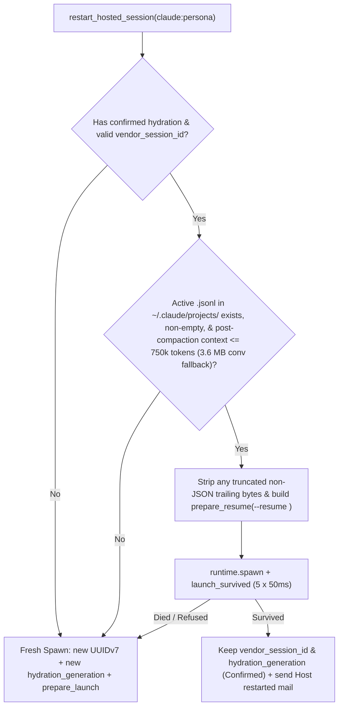

# Claude-Hosted Session `--resume` on Respawn (Issue #433, Path 1) — Design Specification

Status: Revised on 2026-11-09 (`feira/claude-resume-respawn-433-spec`, Issue #433 Path 1) incorporating `ferris` R1 review and `Spike433` empirical results.

---

## 1. Problem Statement (`#433`)

Every restart or redeploy of `ferroloop-host.service` (`fl-host`) terminates the child PTY processes supervised inside `fl-host`, including hosted Claude Code agents (`Ferris`, `Hector`, `Sonya`, `Kayla`). When those hosted sessions are subsequently respawned via `restart_hosted_session` (`POST /api/v1/sessions/:id/restart`) or re-spun via `spin_up` (`POST /api/v1/sessions/spin-up`), `fl-hub` launches a brand-new Claude Code conversation (`claude --remote-control --permission-mode <mode> --session-id <id> --name <DisplayName> ... <hydration_prompt>`).

Meanwhile, the prior Claude process's Remote Control bridge session (`bridgeSessionId` in `~/.claude/sessions/<pid>.json`, persisted as `cse_...` in `<uuid>.jsonl`) was archived or orphaned when `fl-host` stopped. Because `fl-hub` spawns a fresh `--session-id <new_uuid>` instead of resuming `--resume <existing_uuid>`, each `fl-host` restart creates a brand-new `bridgeSessionId` and leaves the prior bridge session in the owner's Claude Recents list (4 stale entries per restart across `Ferris`, `Hector`, `Sonya`, and `Kayla`), discards the agent's in-flight conversation context, and pays a full startup hydration turn (~10k–25k tokens and 15–45 seconds).

### Central Question for Path 1

Does resuming the recorded `vendor_session_id` via `claude --remote-control ... --resume <vendor_session_id> --name <DisplayName>` reuse both the local conversation transcript (`sessionId`) **and** the Remote Control bridge session (`bridgeSessionId` / `cse_...`) across `SIGTERM`, `SIGKILL`, and `/exit` restarts (**Outcome A**), or does `--remote-control` mint a new `bridgeSessionId` on resume (**Outcome B**)?

**Empirical Answer (Section 2): Outcome A holds across all exit modes (`/exit`, `SIGTERM`, and `SIGKILL`).** Path 1 alone reattaches to the persisted `bridgeSessionId` (`cse_...`), unarchives it on Anthropic's Remote Control backend, advances its worker epoch in place, and avoids minting a new Recents entry.

---

## 2. Empirical Spike Results (`Spike433` in Isolated `tmux -L spike433`)

Before touching any product code or live agent session, we ran a controlled 5-part spike (`1a`, `1b`, `1c`, `1b-sigkill`, `3`, and `1d`) in `/home/lmcfarlin/Projects/Artificial-Humanity/scratch/ferroloop/spike-433` under an isolated tmux server (`tmux -L spike433`).

- **Environment:**
  - `claude --version`: `2.1.321 (Claude Code)`
  - Isolated working directory: `/home/lmcfarlin/Projects/Artificial-Humanity/scratch/ferroloop/spike-433`
  - Isolated tmux socket: `tmux -L spike433` (zero interaction with `fl-host`, `fl-hub`, or the default tmux server; live agents `Ferris` `2418692`, `Hector` `2419253`, `Kayla` `2419777`, `Sonya` `2420525` remained untouched throughout).
  - Session display name for owner Recents verification: `Spike433`
  - Primary UUID (`1a`–`3b`): `4d9bd978-abdb-432c-9f25-e002b9b3ae61`
  - Fresh-spawn control UUID (`1d`): `e78ba6f3-583b-4072-8a93-4b180e192e89`

### 2.1 Sub-Experiment Summary Table

| Step | Action / Command | PID | `sessionId` | `bridgeSessionId` (`~/.claude/sessions/<pid>.json` / JSONL `cse_...`) | Worker Epoch | Bridge Lifecycle Event in `--debug-file` |
| :--- | :--- | :--- | :--- | :--- | :--- | :--- |
| **1a** | Fresh launch: `claude --remote-control --permission-mode auto --session-id 4d9bd978-abdb-432c-9f25-e002b9b3ae61 --name Spike433 'Reply with the single word ALPHA.'` | `152733` | `4d9bd978-...` | `session_01SP4ortBQU3hQGNi4NtM8pN` (`cse_01SP4ortBQU3hQGNi4NtM8pN`) | `epoch=1` | `[remote-bridge] Created session cse_01SP4ortBQU3hQGNi4NtM8pN` |
| **1b** | `kill -TERM 152733` (matches `fl-host` stop), then `claude --remote-control --permission-mode auto --resume 4d9bd978-abdb-432c-9f25-e002b9b3ae61 --name Spike433` | `155728` | **`same`** (`4d9bd978-...`) | **`same`** (`session_01SP4ortBQU3hQGNi4NtM8pN`) | `epoch=3` | On `SIGTERM`: `Archive cse_01SP4ortBQU3hQGNi4NtM8pN status=200`. On `--resume`: `Reattaching to persisted bridge session cse_01SP4ortBQU3hQGNi4NtM8pN at seq 18` -> `Unarchive ... status=200` |
| **1c** | Graceful `/exit` on `155728`, then `claude --remote-control --permission-mode auto --resume 4d9bd978-abdb-432c-9f25-e002b9b3ae61 --name Spike433` | `157935` | **`same`** (`4d9bd978-...`) | **`same`** (`session_01SP4ortBQU3hQGNi4NtM8pN`) | `epoch=5` | On `/exit`: `presence clear` + `Archive cse_01SP4ortBQU3hQGNi4NtM8pN status=200`. On `--resume`: `Reattaching to persisted bridge session ... at seq 24` -> `Unarchive ... status=200` |
| **1b-kill9** | `kill -KILL 157935` (hard kill without teardown), then `claude --remote-control --permission-mode auto --resume 4d9bd978-abdb-432c-9f25-e002b9b3ae61 --name Spike433` | `159618` | **`same`** (`4d9bd978-...`) | **`same`** (`session_01SP4ortBQU3hQGNi4NtM8pN`) | `epoch=6` | On `--resume`: `Reattaching to persisted bridge session ... at seq 24` -> `Unarchive ... status=409` (already unarchived) -> `v2 transport connected (epoch=6)` |
| **3a/3b** | Mid-tool-call `kill -TERM 168376` while foreground `Bash` (`python3 -c "... time.sleep(25)"`, `toolu_01CSgTocp6F5DXW47yNSYL82`) was running, then `--resume` + `'Reply with the single word RECOVERED.'` | `170433` | **`same`** (`4d9bd978-...`) | **`same`** (`session_01SP4ortBQU3hQGNi4NtM8pN`) | `epoch=8` | Synthesized `tool_result` (`is_error: true`, `toolDenialKind: "interrupted"`) + `<synthetic>` assistant turn on startup; answered `RECOVERED` on next turn with zero error |
| **1d** | Graceful `/exit`, then fresh `--session-id e78ba6f3-583b-4072-8a93-4b180e192e89 --name Spike433 'Reply with the single word BETA.'` | `174838` | **`NEW`** (`e78ba6f3-...`) | **`NEW`** (`session_01SP4orrAVbPU6CHZ4pBMcti` / `cse_01SP4orrAVbPU6CHZ4pBMcti`) | `epoch=1` | `[remote-bridge] Created session cse_01SP4orrAVbPU6CHZ4pBMcti` (old `cse_01SP4ortBQU3hQGNi4NtM8pN` left behind) |

### 2.2 Exact `claude-session-snapshot.py diff` Outputs and Debug Log Evidence

1. **Why `--resume` preserves `bridgeSessionId` (Steps `1a -> 1b`, `1b -> 1c`, `1c -> 1b-sigkill`):**
   - On initial launch (`1a`), Claude Code writes a `{"type": "bridge-session"}` record into `<uuid>.jsonl`:
     ```json
     {"type":"bridge-session","sessionId":"4d9bd978-abdb-432c-9f25-e002b9b3ae61","bridgeSessionId":"cse_01SP4ortBQU3hQGNi4NtM8pN","lastSequenceNum":0,"ownerAccountUuid":"cd892d18-763f-485a-8f7b-44a013d21801","ownerOrganizationUuid":"3406e86e-75d9-4aa5-9b48-388378d3902b"}
     ```
   - When `kill -TERM` hits the process (`1b`), Claude Code traps `SIGTERM`, archives the bridge session, and exits cleanly (`debug-1a.log`):
     ```text
     2026-11-09T20:15:51.677Z [DEBUG] [code-session] Archive cse_01SP4ortBQU3hQGNi4NtM8pN status=200
     2026-11-09T20:15:51.792Z [DEBUG] [remote-bridge] Torn down (archive=200)
     ```
   - When relaunched with `claude --remote-control --permission-mode auto --resume 4d9bd978-abdb-432c-9f25-e002b9b3ae61 --name Spike433` (`debug-1b.log`), Claude Code reads the `bridge-session` entry from `4d9bd978-abdb-432c-9f25-e002b9b3ae61.jsonl`, **reattaches** to `cse_01SP4ortBQU3hQGNi4NtM8pN`, and **unarchives** it:
     ```text
     2026-11-09T20:15:52.519Z [DEBUG] [bridge:repl] Reattaching to persisted bridge session cse_01SP4ortBQU3hQGNi4NtM8pN at seq 18 (fresh-mint fallback, restored_owner_match)
     2026-11-09T20:15:52.628Z [DEBUG] [remote-bridge] Reattaching to session cse_01SP4ortBQU3hQGNi4NtM8pN
     2026-11-09T20:15:52.838Z [DEBUG] [code-session] Unarchive cse_01SP4ortBQU3hQGNi4NtM8pN status=200
     2026-11-09T20:15:52.998Z [DEBUG] [bridge:repl] CCR v2: worker sessionId=[REDACTED] epoch=3 (from /bridge)
     2026-11-09T20:15:53.189Z [DEBUG] [remote-bridge] v2 transport connected
     ```
   - Even when killed with `SIGKILL` (`kill -9`, where `Archive` could not run on exit), `--resume` still reattaches to `cse_01SP4ortBQU3hQGNi4NtM8pN` (`Unarchive` returns HTTP `409` because it was never archived, which Claude Code treats as a non-fatal no-op and connects `epoch=6`).
   - Snapshot diff (`claude-session-snapshot.py diff snap-1a.json snap-1b.json`):
     ```text
     claude processes: 4 -> 4
     session files:    5 -> 5
     Ferris: pid 2418692->2418692 sessionId same bridge same
     Hector: pid 2419253->2419253 sessionId same bridge same
     Kayla: pid 2419777->2419777 sessionId same bridge same
     Sonya: pid 2420525->2420525 sessionId same bridge same
     Spike433: pid 152733->155728 sessionId same bridge same
     after: session files with dead pid: 0; claude pids without a session file: []
     ```

2. **Why today's fresh `--session-id` respawn creates disconnected Recents entries (Step `1d` control):**
   - Even after a graceful `/exit` (which calls `Archive cse_01SP4ortBQU3hQGNi4NtM8pN status=200`), launching a fresh `--session-id e78ba6f3-583b-4072-8a93-4b180e192e89 --name Spike433` mints a second Remote Control session `cse_01SP4orrAVbPU6CHZ4pBMcti`:
     ```text
     Spike433: pid 170433->174838 sessionId NEW bridge NEW (old one becomes a disconnected Recents entry)
     ```
   - **Conclusion on Path 1 vs. Path 2:** Graceful exit (`Path 2`) does **not** prevent a new Recents entry if the next process launches with a new `--session-id`, whereas `--resume <vendor_session_id>` (`Path 1`) reattaches and unarchives the existing `cse_...` bridge session across `/exit`, `SIGTERM`, and `SIGKILL`. Therefore, **Path 1 is the primary fix for `#433`**, not merely a token optimization.

3. **Interrupted Turn (`kill -TERM` Mid-Tool-Call, Step `3`):**
   - While `Spike433` (PID `168376`) was executing a foreground `Bash` tool call (`python3 -c "import time; print(999, flush=True); time.sleep(25)"`, `tool_use` ID `toolu_01CSgTocp6F5DXW47yNSYL82` at JSONL line `135`), we sent `kill -TERM 168376`.
   - On `SIGTERM`, Claude Code flushed `bridge-session`, `cost-state`, `last-prompt`, and `tools-used` (lines `136`–`140`), leaving `toolu_01CSgTocp6F5DXW47yNSYL82` at the tail with **no `tool_result`**.
   - Upon `claude --remote-control --permission-mode auto --resume 4d9bd978-abdb-432c-9f25-e002b9b3ae61 --name Spike433`, Claude Code v2.1.321 **automatically detected the dangling `tool_use`** and appended two synthetic recovery records (lines `142`–`143`) before opening the prompt:
     ```json
     {"parentUuid":"717ddb4c-9d02-42a5-bc9c-bcca3058cdfe","isSidechain":false,"type":"user","message":{"role":"user","content":[{"type":"tool_result","content":"[Tool call interrupted: the session ended before this call's result was recorded, so its outcome is unknown. Check whether it took effect before relying on it or running it again.]","is_error":true,"tool_use_id":"toolu_01CSgTocp6F5DXW47yNSYL82"}]},"uuid":"0fcbc1aa-57cd-46a2-bd95-736ae3427193","timestamp":"2026-11-09T20:19:18.411Z","toolDenialKind":"interrupted","sourceToolAssistantUUID":"717ddb4c-9d02-42a5-bc9c-bcca3058cdfe",...}
     {"parentUuid":"0fcbc1aa-57cd-46a2-bd95-736ae3427193","isSidechain":false,"type":"assistant","uuid":"425090fa-ac32-44fb-8ac1-b320c00c982e","timestamp":"2026-11-09T20:19:18.411Z","message":{"model":"<synthetic>","role":"assistant","stop_reason":"stop_sequence","type":"message","usage":{"input_tokens":0,"output_tokens":0,"cache_creation_input_tokens":0,"cache_read_input_tokens":0,...},"content":[{"type":"text","text":"No response requested."}]},"isApiErrorMessage":false,...}
     ```
   - TUI rendered:
     ```text
     Ran 1 shell command
     ⎿  Interrupted · What should Claude do instead?
     ```
   - When we sent the follow-up turn `Reply with the single word RECOVERED.`, Claude Code succeeded on the first try (`● RECOVERED`, line `151`, `input_tokens: 4, cache_creation_input_tokens: 196, cache_read_input_tokens: 55259`).

---

## 3. How the Claude Adapter and Hub Lifecycle Build the Spawn Argv Today

### 3.1 Adapter Layer (`crates/vendor-adapters/src/claude.rs`)

`ClaudeHostAdapter` (`crates/vendor-adapters/src/claude.rs:48-50`) already implements both fresh launch and explicit session resume on the `VendorHostAdapter` trait:

1. **`ClaudeHostAdapter::prepare_launch` (`crates/vendor-adapters/src/claude.rs:451-513`):**
   - Takes `&VendorLaunchRequest` and builds:
     ```text
     claude [--remote-control] <posture_launch_args> [--session-id <vendor_session_id> [--name <DisplayName>]] [--model <model>] [--effort <effort>] [<initial_prompt>]
     ```
   - Places `--remote-control` before `--permission-mode <mode>` (`crates/vendor-adapters/src/claude.rs:455-478`) so Commander.js `--remote-control [name]` never consumes a trailing positional `<initial_prompt>`.
   - Appends `safe_positional_prompt(&request.initial_prompt)` (`crates/vendor-adapters/src/claude.rs:500-502`) as the startup hydration prompt.

2. **`ClaudeHostAdapter::prepare_resume` (`crates/vendor-adapters/src/claude.rs:515-566`):**
   - Already exists and is unit-tested (`prepare_resume_requires_explicit_session_id_and_never_uses_continue` at `crates/vendor-adapters/src/claude.rs:1150-1192`), but has **zero production callers** in `crates/hub/`.
   - Validates `request.vendor_session_id` via `validate_required_session_id(&request.vendor_session_id, "prepare_resume")` (`crates/vendor-adapters/src/claude.rs:532-533`), forbidding `--continue` and newest-by-`mtime` scanning.
   - Builds:
     ```text
     claude [--remote-control] <posture_launch_args> --resume <vendor_session_id> [--name <DisplayName>] [--model <model>] [--effort <effort>]
     ```
   - Takes **no** positional `initial_prompt` argument.

### 3.2 Hub Lifecycle Layer (`crates/hub/src/lifecycle.rs`)

Today, both lifecycle entry points that spawn or respawn a hosted Claude runtime bypass `prepare_resume`:

1. **`launch_spec_for_with_session` (`crates/hub/src/lifecycle.rs:762-872`):**
   - Constructs a `fl_core::VendorLaunchRequest` and unconditionally calls `host_adapter.prepare_launch(&req)` (`crates/hub/src/lifecycle.rs:801`), passing `vendor_session_id` into `--session-id <uuid>` and `prompt` as the positional initial prompt.
   - There is no `resume_spec_for_with_session` helper in `crates/hub/src/lifecycle.rs` that constructs an `fl_core::AttachOrResumeRequest` and calls `host_adapter.prepare_resume(&req)`.

2. **`restart_hosted_session` (`crates/hub/src/lifecycle.rs:5640-5826`):**
   - Preserves `record.vendor_session_id` if already populated on `HostedSessionRecord`, minting a new UUIDv7 only when `record.vendor_session_id` is `None` or blank (`crates/hub/src/lifecycle.rs:5669-5676`).
   - However, at lines `5741-5760`, `restart_hosted_session` passes that preserved `record.vendor_session_id` to `launch_spec_for_with_session(...)`, which invokes `prepare_launch` (`claude ... --session-id <existing_uuid> ... <hydration_prompt>`) instead of `prepare_resume` (`claude ... --resume <existing_uuid>`).

3. **`spin_up` (`crates/hub/src/lifecycle.rs:4148-4391`):**
   - Even when `previous` (`find_hosted_session(store, &[&session_id])` at `crates/hub/src/lifecycle.rs:4193-4194`) is a live or `stopped` hosted record for the same `claude:<persona>` session, line `4242` unconditionally overwrites `vendor_session_id` with a brand-new UUIDv7:
     ```rust
     let vendor_session_id = (v.vendor == "claude").then(|| uuid::Uuid::now_v7().to_string());
     ```

---

## 4. What Is Recorded in `HostedSessionRecord` (`vendor_session_id`) and Reliability Analysis

### 4.1 Lifecycle of `HostedSessionRecord.vendor_session_id`

`HostedSessionRecord` (`crates/hub/src/lifecycle.rs:2144-2200`) stores the vendor-native session UUID in:

```rust
/// Vendor-native session identifier (e.g., Claude `--session-id <uuid>`).
#[serde(default, skip_serializing_if = "Option::is_none")]
pub vendor_session_id: Option<String>,
```

At `spin_up`:
1. `vendor_session_id` is minted as `Uuid::now_v7().to_string()` (`crates/hub/src/lifecycle.rs:4242`).
2. `persist_hosted_session(store, &record, by)` (`crates/hub/src/lifecycle.rs:2496-2531`, called at line `4310`) writes the `HostedSessionRecord` to `fl-store` under workspace runtime slug `hosted-session-claude-<persona>` **before** `env.runtime.spawn(...)` runs (`crates/hub/src/lifecycle.rs:4318-4327`).
3. `env.runtime.spawn` launches `claude --remote-control ... --session-id <vendor_session_id> --name <DisplayName> ...`.

### 4.2 Three On-Disk Artifacts per Claude Session

Across the host, three artifacts track the session:

1. **`fl-store` (`hosted-session-claude-<persona>`):**
   - Holds `HostedSessionRecord.vendor_session_id: Some("<uuid>")`.
   - Durable across `fl-host` restarts, `fl-hub` restarts, and host reboots.
2. **`~/.claude/sessions/<pid>.json` (and `<pid>.<sha256>.key`):**
   - Ephemeral process metadata written by Claude Code while `<pid>` is alive, inspected by `discover_claude_routes` (`crates/wire/src/identity.rs:1200-1274`) and `claude-session-snapshot.py`:
     - `pid`: OS PID of the `claude` process
     - `name`: `<DisplayName>` passed via `--name` (e.g., `"Ferris"`)
     - `sessionId`: `<vendor_session_id>` UUID
     - `bridgeSessionId`: Remote Control session ID (`"session_01..."`) shown in Claude Recents
     - `messagingSocketPath`: Unix domain socket for `fl-wire` push delivery
     - `cwd`, `startedAt`, `status`, `version`
   - When `fl-host` stops and kills its child processes, `<pid>` dies; `discover_claude_routes` filters dead PIDs out via `Path::new(&format!("/proc/{pid}")).exists()` (`crates/wire/src/identity.rs:1227`).
3. **`~/.claude/projects/<project-slug>/<vendor_session_id>.jsonl`:**
   - Append-only JSONL conversation transcript written by Claude Code on every turn, including `{"type": "bridge-session", "sessionId": "<uuid>", "bridgeSessionId": "cse_01..."}` which `--remote-control --resume` uses to reattach the Remote Control bridge.
   - Located deterministically by `ClaudeHostAdapter::find_session_transcript_path(home_dir, vendor_session_id)` (`crates/vendor-adapters/src/claude.rs:97-124`), which matches only the exact `<vendor_session_id>.jsonl` filename under `~/.claude/projects/*/` (and `~/.claude/archived/*/`), never scanning by `mtime`.

### 4.3 Reliability Analysis and the `/clear` Drift Edge Case

- **Normal operation and `fl-host` restarts:** **100% match.** Because `--session-id <uuid>` is passed on initial launch and persisted to `fl-store` before spawn, `HostedSessionRecord.vendor_session_id` matches both `~/.claude/sessions/<pid>.json`'s `sessionId` and `~/.claude/projects/<project-slug>/<uuid>.jsonl`.
- **Single drift edge case — interactive `/clear` inside a running session:**
  - If an operator attaches to the terminal and runs `/clear` inside Claude Code without going through `fl-hub`, Claude Code rotates its active `sessionId` in `~/.claude/sessions/<pid>.json` and opens a new `<new_uuid>.jsonl` transcript, while `HostedSessionRecord.vendor_session_id` in `fl-store` still holds the initial `<uuid>`.
  - Meanwhile, `discover_claude_routes` (`crates/wire/src/identity.rs:1257-1272`) and `fl wire hook claude` (`crates/cli/src/cmd/wire.rs:1344-1384`) update `VendorRoute::Claude { session_id, .. }` in `routes.json` to `<new_uuid>`.
- **Closing the drift:**
  - Whenever `reconcile_dead_hosted_sessions` (`crates/hub/src/lifecycle.rs:5242-5292`) sees a live `VendorRoute::Claude { session_id, .. }` for `record.persona` whose `session_id` is a valid non-empty Claude session ID (`is_native_session_id(&session_id)`) that differs from `record.vendor_session_id` (and is not in `record.tombstone_ids`), or at the start of `restart_hosted_session` before the old route is replaced, `fl-hub` syncs `record.vendor_session_id = Some(route_session_id)` if `<route_session_id>.jsonl` exists under `~/.claude/projects/`.

---

## 5. Interaction with `#406` Generation-Fenced Hydration, Route Re-Binding, and Stale Instructions After Deploy

### 5.1 Why Treating `--resume` Like a Fresh Launch Breaks `#406`

Under Issue `#406` ([`2026-11-09-hydration-acceptance-406-design.md`](2026-11-09-hydration-acceptance-406-design.md) and `crates/hub/src/lifecycle.rs:2215-2494`):
- A fresh launch mints `G1 = next_hydration_generation()`, sets `record.hydration_generation = Some(G1)` and `record.hydration_status = HydrationStatus::Unconfirmed`, embeds `AGENT_PERSONA=<persona> AGENT_HYDRATION_GENERATION=<G1> fl wire register <Name> --project <project> --role <role> --replace` in Step 6 of the positional hydration prompt, and passes `AGENT_HYDRATION_GENERATION=<G1>` in the spawned process environment (`apply_vendor_launch_env`, `crates/hub/src/lifecycle.rs:697-714`).
- When the agent executes Step 6, `record_hydration_ack` (`crates/hub/src/lifecycle.rs:2424-2494`) writes workspace runtime entry `hydration-ack-<G1>`, and `promote_confirmed_hydration` / `list_hosted_sessions` (`crates/hub/src/lifecycle.rs:2309-2328`, `2558-2566`) projects `record.hydration_status = HydrationStatus::Confirmed`.
- When `persist_hosted_session` runs (`crates/hub/src/lifecycle.rs:2524`), `prune_stale_hydration_receipts` (`crates/hub/src/lifecycle.rs:2330-2365`) deletes any `hydration-ack-*` for `persona` whose generation does not match `record.hydration_generation`.

If `restart_hosted_session` on `--resume` minted a new generation `G2`, reset `record.hydration_status = HydrationStatus::Unconfirmed`, and pruned `hydration-ack-<G1>`, two bugs would occur immediately:
1. **Permanent `Unconfirmed` status:** `ClaudeHostAdapter::prepare_resume` takes no positional prompt, and a resumed session does not re-run startup hydration Step 6 unless prompted. Thus `hydration-ack-<G2>` would never be written, leaving `hydration_status` stuck at `Unconfirmed`.
2. **False stale-generation refusal (`fence_hydration_register`):** The resumed Claude transcript still contains the earlier Step 6 command string `AGENT_PERSONA=<persona> AGENT_HYDRATION_GENERATION=<G1> fl wire register ... --replace` in its conversation history. If the agent ever re-ran that command from history while `record.hydration_generation == Some(G2)`, `fence_hydration_register` (`crates/hub/src/lifecycle.rs:2369-2419`) would see `G1 < G2` and refuse it as superseded.

### 5.2 Exact `#406`-Compatible Design for Resumed Sessions

A resume (`prepare_resume`) is a **process continuation of the same hydrated conversation**, not a new hydration submission. This aligns directly with `#406` Amendment A8 ("Reuse generation when no new hydration submission is issued"):

1. **Eligibility for Resume (`ResumeEligibility::ResumeExisting`):**
   `restart_hosted_session` (and `spin_up` when re-spinning a `stopped` record of the same `claude:<persona>` session) selects `prepare_resume` when **all** of the following hold:
   - `record.vendor == "claude"` and `record.hosted && env.spawn_runtime`;
   - `record.vendor_session_id` is `Some(sid)` with a valid session UUID not present in `record.tombstone_ids`;
   - `record.hydration_status == HydrationStatus::Confirmed` (projected via `list_hosted_sessions` / `promote_confirmed_hydration`, proving the session accepted its initial hydration before dying) and `record.hydration_generation` is `Some(g)` with `is_valid_hydration_generation(&g)`;
   - No recast guidance is staged (`!recast_guidance_required`, i.e. the agent's project and role have not been reassigned since the session ran);
   - The transcript file at `~/.claude/projects/<project-slug>/<sid>.jsonl` (not in `archived/`) exists, is non-empty, has at least one valid normalized turn, and passes the **post-compaction context eligibility check** (Section 6).

2. **No Re-Hydration Prompt on `--resume`:**
   - `restart_hosted_session` builds the `LaunchSpec` via `resume_spec_for_with_session` -> `ClaudeHostAdapter::prepare_resume`, which passes `--resume <sid>` and **no** positional hydration prompt.

3. **Preserving `hydration_generation` and `hydration-ack-<G1>`:**
   - When `ResumeEligibility::ResumeExisting` is chosen and the `--resume` spawn survives `launch_survived`:
     - `record.hydration_generation` stays at `Some(G1)` (not incremented to `G2`).
     - `hydration-ack-<G1>` in `fl-store` is **not** deleted before or after spawn (`prune_stale_hydration_receipts` retains it because `G1` remains in `active_generations`).
     - `apply_vendor_launch_env` injects `AGENT_HYDRATION_GENERATION=<G1>` into the resumed child's environment.
     - `record.hydration_dispatched` remains `true`, and `record.hydration_status` remains `HydrationStatus::Confirmed`.
     - If a subsequent restart falls back to a fresh spawn (`prepare_launch`), `fl-hub` mints `G2 > G1`, prunes `hydration-ack-<G1>`, and fences out any lingering `G1` subshell as required by `#406` Case 4.

4. **Route Re-Binding for the New PID:**
   - `claude --remote-control ... --resume <sid> --name <DisplayName>` starts a new OS process with a new `pid` and creates `~/.claude/sessions/<new_pid>.json` with `"name": "<DisplayName>"`, `"sessionId": "<sid>"`, and a new `"messagingSocketPath"`.
   - As verified in `Spike433` Step `3b` (`line 145` of the JSONL transcript), Claude Code fires `SessionStart:resume` (`fl wire hook claude`, `crates/cli/src/cmd/wire.rs:1316-1384`) on `--resume`, immediately registering the new PID's route in `routes.json`.
   - `crate::discovery::invalidate_route_discovery_cache()` (`crates/hub/src/lifecycle.rs:5815`) also ensures `discover_claude_routes` (`crates/wire/src/identity.rs:1200-1274`) prunes the dead `<old_pid>` entry and binds `VendorRoute::Claude { pid: new_pid, session_id: sid, socket_path: new_socket, key_path: new_key }`.

### 5.3 Stale Instructions After a Deploy (`"Host restarted"` System Mail)

Because `claude --resume` does not re-send the hydration prompt—and because Claude Code's `--system-prompt-snapshot` defaults to `on` (`claude --help`: *"the prompt is rendered on the conversation's first turn and recorded; every later request and resume sends the record as-is"*), a resumed session retains its pre-deploy reading of `AGENTS.md`, `WORKFLOW.md`, `PERSONA.md`, and its role guidance file.

Today, the `"Host restarted"` system mail is constructed in `crates/hub/src/boot_reconcile.rs:69-74` and sent by `send_notice` (`crates/hub/src/boot_reconcile.rs:338-358`):

```rust
pub(crate) const NOTICE_SUBJECT: &str = "Host restarted";
pub(crate) const NOTICE_BODY: &str = "The host restarted. Resume your task from your last handoff (`fl state handoff get ...`) and reply to confirm.";
```

To prevent instruction drift across deploys and host restarts without paying a full re-hydration turn:

1. **Update `NOTICE_BODY` in `crates/hub/src/boot_reconcile.rs:71-72` (and a shared helper `format_host_restarted_notice`):**
   - Instruct resumed sessions to re-read instruction files (`AGENTS.md`, `WORKFLOW.md`, `PERSONA.md`, and their role guidance file) that changed since their hydration timestamp (`hydration-ack-<G>.accepted_at_ms`, falling back to `record.created_at_ms`), rather than re-running full hydration.
   - When `fl-hub` can stat the session's `cwd` (and workspace root) against `baseline_ms = hydration_accepted_at_ms.unwrap_or(record.created_at_ms)`, it checks the candidate instruction files (`AGENTS.md`, `WORKFLOW.md`, `PERSONA.md`, `docs/roles/<role>.md`, `.agents/roles/<role>.md`) for `mtime_ms > baseline_ms`:
     - If one or more instruction files changed since `baseline_ms`, append the explicit list:
       ```text
       The host restarted. Re-read instruction files modified since your hydration before continuing: <comma-separated paths>. Then resume your task from your last handoff (`fl state handoff get ...`) and reply to confirm.
       ```
     - If no `cwd` is resolvable or `mtime` cannot be compared, include the general directive:
       ```text
       The host restarted. Re-read any instruction files (`AGENTS.md`, `WORKFLOW.md`, `PERSONA.md`, or your role guidance file) modified since your hydration, then resume your task from your last handoff (`fl state handoff get ...`) and reply to confirm.
       ```
2. **Send on service-level `--resume` respawns as well as kernel reboots:**
   - `boot_reconcile` only fires when `/proc/sys/kernel/random/boot_id` changes (a full machine reboot). When `restart_hosted_session` (`crates/hub/src/lifecycle.rs:5640-5826`) or `spin_up` (`crates/hub/src/lifecycle.rs:4148-4391`) resumes an existing Claude session (`--resume <vendor_session_id>`) after an `fl-host` service restart/redeploy on the same `boot_id`, `fl-hub` enqueues the same `"Host restarted"` mail (or appends the changed instruction file list) if `boot_reconcile` has not already notified the persona in the current boot.

---

## 6. Post-Compaction Context Eligibility vs. Fresh Spawn

### 6.1 Why Raw `.jsonl` File Size (`4 MiB`) Is the Wrong Metric

Inspecting the live Claude transcripts on `ai-lab-0` (plus a multi-compaction historical transcript `032bc4ff-1451-486f-95ec-69215c9773bc.jsonl`) reveals why total `.jsonl` byte size does not measure resumed context:

| Session | Model | Total `.jsonl` Size (Lines) | Compactions (`compact_boundary`) | Post-Compact Raw Bytes | Post-Compact Conversational Bytes (`user` + `assistant`) | Active Context Tokens (`message.usage`: `in + cc + cr`) |
| :--- | :--- | :--- | :--- | :--- | :--- | :--- |
| **`Ferris`** (`01a1c0d2-322c-...`) | `claude-opus-5-5` (1M) | **4,800.6 KiB** (2,749) | `0` | 4,800.6 KiB | **2,690.2 KiB** | **388,396 tokens** (`2 + 974 + 387,420`) |
| **`Kayla`** (`01a1c0d2-3d7d-...`) | `claude-opus-5-5` (1M) | **1,495.1 KiB** (600) | `0` | 1,495.1 KiB | **752.8 KiB** | **166,143 tokens** (`2 + 618 + 165,523`) |
| **`Hector`** (`01a1c0d2-38ec-...`) | `claude-fable-5-2` (1M) | **1,048.1 KiB** (335) | `0` | 1,048.1 KiB | **278.0 KiB** | **94,671 tokens** (`2 + 607 + 94,062`) |
| **`Sonya`** (`01a1c0d2-427a-...`) | `claude-sonnet-5-5` (1M) | **787.0 KiB** (172) | `0` | 787.0 KiB | **212.9 KiB** | **90,764 tokens** (`2 + 248 + 90,514`) |
| **Historical compacted** (`032bc4ff-...`) | `claude-sonnet-5-5` (1M) | **57,428.6 KiB** (29,139) | `10` (last at line `20955`, `postTokens: 21,769`, dropped `2,818,270`) | 14,774.3 KiB | **5,621.1 KiB** | **895,176 tokens** (`2 + 2,085 + 893,089`) |

Two structural facts stand out from these measurements:
1. **Non-conversational records account for ~40%–73% of raw `.jsonl` bytes:** In `Ferris`'s `4,800.6 KiB` transcript, `attachment` (`811.2 KiB`), `api-request-shape` (`366.7 KiB`), `api-request` (`351.0 KiB`), `queue-operation` (`155.3 KiB`), and `api-request-blob` (`133.3 KiB`) consume ~1.9 MiB of disk space that is never sent to the model on `--resume`.
2. **Claude Code resumes from the last `compact_boundary`, and records exact active context tokens on every real `assistant` turn:**
   - Each auto-compaction writes:
     ```json
     {"type":"system","subtype":"compact_boundary","compactMetadata":{"trigger":"auto","preTokens":301545,"postTokens":21769,"cumulativeDroppedTokens":2818270},...}
     ```
     followed by `{"type":"user","isCompactSummary":true,...}`. Everything prior to the last `compact_boundary` is dropped from the active context window.
   - Furthermore, every non-synthetic `assistant` turn (`message.model != "<synthetic>"`) records the exact active context window size in `message.usage`:
     ```text
     active_context_tokens = input_tokens + cache_creation_input_tokens + cache_read_input_tokens
     ```
     (Note: synthetic recovery turns written on interrupted-turn resume have `message.model == "<synthetic>"` and `usage` all zeros, so they must be skipped when reading the latest usage.)

### 6.2 Post-Compaction Context Estimator and Thresholds

Instead of total file size, `ClaudeHostAdapter::estimate_post_compaction_context(transcript_path)` computes:

1. **Locate the last compaction boundary:**
   - Scan the JSONL lines of `<vendor_session_id>.jsonl`, tracking the last line with `type == "system" && subtype == "compact_boundary"` (recording its `compactMetadata.postTokens` if present).
2. **Compute two post-compaction metrics over the slice after the last `compact_boundary` (or the whole file if never compacted):**
   - **`active_context_tokens: Option<u64>`:** From the last `type == "assistant"` record in that slice where `message.model != "<synthetic>"` and `input_tokens + cache_creation_input_tokens + cache_read_input_tokens > 0`, sum `input_tokens + cache_creation_input_tokens + cache_read_input_tokens`. If no real assistant turn has occurred since the last `compact_boundary`, use `compactMetadata.postTokens`.
   - **`post_compact_conversational_bytes: u64`:** Sum of line byte lengths for non-sidechain conversational records (`type` in `["user", "assistant"]`) after the last `compact_boundary`, excluding telemetry/metadata records (`attachment`, `api-request*`, `queue-operation`, `bridge-session`, `file-history-*`, etc.).
3. **Eligibility Thresholds:**
   - **Primary check (when `active_context_tokens` is `Some(tokens)`):**
     - Default ceiling: `MAX_CLAUDE_RESUME_ACTIVE_TOKENS: u64 = 750_000` (75% of the 1M token window used by `claude-opus-5-5`, `claude-sonnet-5-5`, and `claude-fable-5-2`; overridable via `FL_CLAUDE_MAX_RESUME_ACTIVE_TOKENS`).
     - If the session or model specifies a smaller context window `W` (`record.context_window` or a `[200k]` model window tag), cap at `min(MAX_CLAUDE_RESUME_ACTIVE_TOKENS, W * 3 / 4)` (e.g., `150,000` tokens for a `200k` window).
     - Under this rule, all four current live agents (`Ferris` at `388k`, `Kayla` at `166k`, `Hector` at `95k`, `Sonya` at `91k`) — as well as any 50+ MiB transcript that compacted down to `< 750k` active tokens — **resume cleanly**, while an uncompacted session near context saturation (such as `895k` tokens) falls back to a fresh session.
   - **Fallback check (when `active_context_tokens` is `None`, e.g., synthetic test fixtures without `message.usage`):**
     - Require `post_compact_conversational_bytes <= MAX_CLAUDE_RESUME_POST_COMPACT_CONV_BYTES` where `MAX_CLAUDE_RESUME_POST_COMPACT_CONV_BYTES: u64 = 3_600_000` (~3.43 MiB of post-compaction conversational JSONL, corresponding to ~500k–750k tokens; `Ferris` after 2.5h is `2,690.2 KiB`).

---

## 7. Failure Modes, Interrupted Turns, and Automatic Fallback to Fresh Spawn

Every failure mode on the `--resume` path degrades gracefully to a fresh spawn (`prepare_launch`) within `restart_hosted_session` so a broken or missing transcript never leaves a hosted agent down.



### 7.1 Failure Mode 1: Missing, Archived, or Empty `.jsonl` Transcript

- **Cause:** `spin_up` crashed before Claude wrote its first turn; the transcript was manually deleted or moved to `~/.claude/archived/`; or `/clear` rotated the session ID before any turn was written.
- **Handling:**
  - `ClaudeHostAdapter::find_active_session_transcript_path(home_dir, vendor_session_id)` searches `~/.claude/projects/*/<vendor_session_id>.jsonl` only (excluding `~/.claude/archived/`).
  - Verify `metadata.len() > 0` and `normalize_session_transcript_file(&path, None)` (`crates/vendor-adapters/src/claude.rs:128-142`) returns `!report.turns.is_empty()`.
  - If missing, archived, empty, or zero turns: skip `prepare_resume`, mint a fresh `vendor_session_id = Uuid::now_v7().to_string()` and a fresh `hydration_generation = next_hydration_generation()`, and run `prepare_launch` with the full hydration prompt.

### 7.2 Failure Mode 2: Interrupted Turn (Dangling `tool_use`) vs. Truncated Trailing Bytes

- **Case 2a — Complete JSONL line ending mid-turn (dangling `tool_use` or unanswered `user` prompt):**
  - As proven in `Spike433` Step `3` (Section 2.2), when `fl-host` kills `claude` with `SIGTERM` (or `SIGKILL`) while a tool is running, `<vendor_session_id>.jsonl` ends with a valid JSON `assistant` `tool_use` entry (followed by `bridge-session` / `cost-state` metadata lines) and no `tool_result`.
  - On `claude --resume <id>`, Claude Code v2.1.321 **natively synthesizes** the missing `tool_result` (`is_error: true`, `toolDenialKind: "interrupted"`, content `"[Tool call interrupted: the session ended before this call's result was recorded...]"`) and a `<synthetic>` assistant turn (`"No response requested."`), then accepts the next turn normally.
  - Therefore, **`repair_session_transcript_tail` MUST NOT strip or rewrite complete JSONL lines**—even if the last conversational entry is a `tool_use` without a `tool_result` or a `user` turn without an `assistant` reply. Doing so would break `parentUuid` chains (`leafUuid` in `last-prompt`) and discard Claude Code's own interrupted-turn recovery.
- **Case 2b — Partially flushed (non-JSON) trailing line after abrupt `SIGKILL` or power loss:**
  - `repair_session_transcript_tail(&path)` inspects **only** the final non-empty line of `<vendor_session_id>.jsonl`.
  - If the final non-empty line parses via `serde_json::from_str::<Value>`, `repair_session_transcript_tail` leaves the file **completely untouched**.
  - Only if the final non-empty line fails `serde_json::from_str::<Value>` (a torn write missing its closing `}`) does `repair_session_transcript_tail` truncate the file back to the byte offset immediately after the last complete newline-terminated valid JSON line. If zero valid JSON lines remain, fall back to Failure Mode 1 (fresh spawn).

### 7.3 Failure Mode 3: `claude --resume <id>` Exits Immediately (`!launch_survived`)

- **Cause:** Claude Code rejects `--resume <id>` at startup and exits within `launch_survived` (`LAUNCH_SURVIVAL_CHECKS = 5` checks at `settle_delay() = 50ms` for `HostRuntime`, i.e. 200ms window in `crates/hub/src/lifecycle.rs:573-591`).
- **Handling:**
  - In `restart_hosted_session` (`crates/hub/src/lifecycle.rs:5788-5798`), if the spawn used `prepare_resume` and `!launch_survived(env, &unit, &record.session_id)`:
    1. Ensure the dead unit is cleaned up (`env.runtime.kill(&unit, &record.session_id)`).
    2. Mint a fresh `vendor_session_id = Uuid::now_v7().to_string()` and a fresh `hydration_generation = next_hydration_generation()`.
    3. Re-render the hydration prompt with the new `hydration_generation` (`registered_role_prompt_with_generation`), build a fresh launch spec via `launch_spec_for_with_session` (`prepare_launch`), persist the updated `HostedSessionRecord`, and execute one fallback `env.runtime.spawn` + `launch_survived` check.

---

## 8. Summary of Proposed Code Changes

1. **`crates/vendor-adapters/src/claude.rs`:**
   - Add `find_active_session_transcript_path(&self, home_dir: &Path, vendor_session_id: &str) -> Result<Option<PathBuf>, VendorAdapterError>` (searches `~/.claude/projects/*/<vendor_session_id>.jsonl` only, never `archived/`).
   - Add `repair_session_transcript_tail(&self, transcript_path: &Path) -> Result<usize, VendorAdapterError>` to strip only a torn/non-JSON final line (preserving all complete JSONL lines including dangling `tool_use` entries).
   - Add `estimate_post_compaction_context(&self, transcript_path: &Path) -> Result<ClaudePostCompactionContext, VendorAdapterError>` returning `turn_count`, `active_context_tokens: Option<u64>` (from the last non-`<synthetic>` assistant `message.usage` after the last `compact_boundary`, or `compactMetadata.postTokens`), and `post_compact_conversational_bytes: u64`.
2. **`crates/hub/src/lifecycle.rs` & `crates/hub/src/boot_reconcile.rs`:**
   - Add `MAX_CLAUDE_RESUME_ACTIVE_TOKENS: u64 = 750_000` (env override `FL_CLAUDE_MAX_RESUME_ACTIVE_TOKENS`) and `MAX_CLAUDE_RESUME_POST_COMPACT_CONV_BYTES: u64 = 3_600_000`.
   - Add `resume_spec_for_with_session(...) -> Result<Option<LaunchSpec>, LifecycleError>` calling `host_adapter.prepare_resume(&AttachOrResumeRequest { ... })` and `apply_vendor_launch_env(..., hydration_generation)`.
   - In `restart_hosted_session` (`crates/hub/src/lifecycle.rs:5669-5820`) and `spin_up` (`crates/hub/src/lifecycle.rs:4242`, when re-spinning a non-decommissioned `claude:<persona>` record):
     - Sync `record.vendor_session_id` from a live `VendorRoute::Claude` for `record.persona` if `/clear` rotated it and the new `.jsonl` exists.
     - Evaluate `can_resume_claude_session(store, env, &record)` using `estimate_post_compaction_context`: when eligible, preserve `record.vendor_session_id` and `record.hydration_generation`, build the launch spec via `resume_spec_for_with_session`, keep `record.hydration_status = HydrationStatus::Confirmed` when `launch_survived` succeeds, and send the `"Host restarted"` mail (with any instruction files modified since hydration).
     - If `can_resume_claude_session` is false **or** the `--resume` spawn fails `launch_survived`, fall back to minting a fresh `vendor_session_id = Uuid::now_v7().to_string()` and `hydration_generation = next_hydration_generation()` and spawning via `launch_spec_for_with_session` (`prepare_launch`).
   - Update `crates/hub/src/boot_reconcile.rs:69-74` (`NOTICE_BODY`) to instruct resumed agents to re-read instruction files (`AGENTS.md`, `WORKFLOW.md`, `PERSONA.md`, role guidance) modified since hydration rather than re-running full hydration.

---

## 9. Test Plan (Requiring Only ONE Owner-Observed Recents Check)

### Layer 1 — Unit & Integration Tests (`cargo test`, 0 Live Agent Respawns, 0 Owner Checks)

1. **Adapter transcript preflight, post-compaction context estimator, & tail repair (`crates/vendor-adapters/src/claude.rs`):**
   - `find_active_session_transcript_path` returns `Some(path)` for `~/.claude/projects/<slug>/<uuid>.jsonl` and `None` when the file is only in `~/.claude/archived/<slug>/<uuid>.jsonl` or missing.
   - `estimate_post_compaction_context`:
     - Correctly computes `active_context_tokens` from `input_tokens + cache_creation_input_tokens + cache_read_input_tokens` on the last non-`<synthetic>` `assistant` turn (`388,396` on the `Ferris` fixture), ignoring `<synthetic>` `0`-token recovery turns.
     - Ignores pre-compaction turns and bytes before the last `{"type":"system","subtype":"compact_boundary"}` line (so a 57 MiB transcript that compacted down to `21,769` `postTokens` is eligible to resume).
     - Excludes `attachment`, `api-request*`, `queue-operation`, and `bridge-session` lines from `post_compact_conversational_bytes`.
   - `repair_session_transcript_tail`:
     - Leaves a complete JSONL transcript ending with a dangling `tool_use` (`stop_reason: "tool_use"`) **untouched**.
     - Strips only a torn trailing non-JSON line (`{"type":"assistant","message":`) while preserving all preceding valid JSONL lines.
2. **Lifecycle resume & fallback paths (`crates/hub/src/lifecycle.rs` & `crates/hub/src/boot_reconcile.rs`):**
   - `restart_hosted_session_resumes_confirmed_claude_session_with_existing_transcript`:
     - Asserts `LaunchSpec.argv` contains `["--remote-control", "--permission-mode", "auto", "--resume", "<vendor_session_id>", "--name", "Ada"]` with **no** `--session-id` and **no** trailing positional hydration prompt.
     - Asserts `vendor_session_id`, `hydration_generation`, `HydrationStatus::Confirmed`, and `hydration-ack-<G1>` are preserved, and the `"Host restarted"` mail is queued with the re-read instruction directive.
   - Fallback tests for: (a) missing/empty `.jsonl`, (b) `active_context_tokens > MAX_CLAUDE_RESUME_ACTIVE_TOKENS` (`750,000`), (c) `HydrationStatus::Unconfirmed`, and (d) `--resume` process dying within `launch_survived` (`vanish_windows` on first spawn retrying once with a fresh UUIDv7 + `prepare_launch`).

### Layer 2 — Automated Host-Side Metadata Verification (`claude-session-snapshot.py`, 0 Owner Checks)

Completed during `Spike433` (Section 2) using `/home/lmcfarlin/Projects/Artificial-Humanity/scratch/ferroloop/claude-session-snapshot.py`:
- Snapshots written to `/home/lmcfarlin/Projects/Artificial-Humanity/scratch/ferroloop/spike-433/snap-1a.json`, `snap-1b.json`, `snap-1c.json`, `snap-1b-sigkill.json`, `snap-3b.json`, and `snap-1d.json` (and cleaned up after extracting diffs into Section 2).
- Confirmed `sessionId same` and `bridge same` (`cse_01SP4ortBQU3hQGNi4NtM8pN`) across `SIGTERM`, `/exit`, `SIGKILL`, and mid-tool-call `SIGTERM` resumes, and `sessionId NEW bridge NEW` (`cse_01SP4orrAVbPU6CHZ4pBMcti`) on fresh `--session-id` control.

### Layer 3 — Single Owner-Observed Recents Check (1 Check Total, Using `Spike433` Entries)

Because `Spike433` already ran both the 4-x `--resume` sequence (`sessionId`: `4d9bd978-abdb-432c-9f25-e002b9b3ae61`, `bridgeSessionId`: `session_01SP4ortBQU3hQGNi4NtM8pN`) and the 1-x fresh `--session-id` control (`sessionId`: `e78ba6f3-583b-4072-8a93-4b180e192e89`, `bridgeSessionId`: `session_01SP4orrAVbPU6CHZ4pBMcti`), only **one** owner check is needed before implementation:
- Ask the owner once to check the `Spike433` entries in Claude Recents (confirming that the 4 `--resume` cycles produced a single `Spike433` entry for `4d9bd978-...` rather than 5 separate entries, alongside the 1 control entry for `e78ba6f3-...`).
